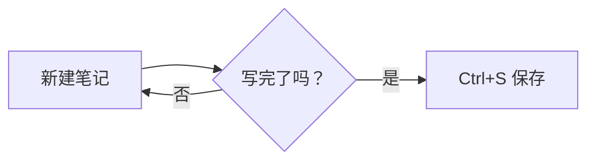

# Markdown 示例

这篇笔记演示 LightTextEditor 支持的 Markdown 格式。按 **Ctrl+E** 在源码和预览之间切换，对照着看每种写法的效果。

> 这篇示例可以随意修改或删除。需要时可以从菜单“帮助 → Markdown 示例”重新打开一份。

## 1. 标题

用 `#` 到 `######` 表示一到六级标题：

# 一级标题
## 二级标题
### 三级标题
#### 四级标题
##### 五级标题
###### 六级标题

## 2. 文字格式

| 效果 | 写法 |
|------|------|
| **加粗** | `**加粗**` |
| *斜体* | `*斜体*` |
| ***粗斜体*** | `***粗斜体***` |
| ~~删除线~~ | `~~删除线~~` |
| `行内代码` | `` `行内代码` `` |
| <u>下划线</u> | `<u>下划线</u>` 或 `++下划线++` |
| <mark>高亮</mark> | `<mark>高亮</mark>` 或 `==高亮==` |
| H<sub>2</sub>O | `H<sub>2</sub>O` 或 `H~2~O` |
| x<sup>2</sup> | `x<sup>2</sup>` 或 `x^2^` |

段落之间空一行。在行尾写 `<br>`<br>可以在段落内换行。

## 3. 链接与图片

- 网址：[Avalonia 官网](https://avaloniaui.net)，或直接写 <https://www.example.com>
- 指向其他笔记的相对链接，在预览中点击会在编辑器里打开：[打开本文件](Markdown%20示例.md)

图片用 ``，路径相对于当前文件：


> **提示**：在 Markdown 文件里按 **Ctrl+V** 可以直接粘贴截图，或把图片文件拖进编辑器。图片会保存到 `assets` 文件夹，并自动插入图片标签。

## 4. 列表

无序列表：

- 苹果
- 香蕉
  - 嵌套的项目
  - 再缩进两个空格即可
- 橙子

有序列表：

1. 第一步
2. 第二步
3. 第三步

任务列表：

- [x] 已完成的任务
- [ ] 未完成的任务

## 5. 引用

> 读书破万卷，下笔如有神。
>
> > 引用可以嵌套。

> [!NOTE]
> 这是 GitHub 风格的提示框，还有 `[!TIP]`、`[!IMPORTANT]`、`[!WARNING]`、`[!CAUTION]`。

> [!WARNING]
> 修改前记得保存（Ctrl+S）。

## 6. 代码

行内代码：`Console.WriteLine("你好");`

代码块用三个反引号包起来，并写上语言名称，就会按语言着色：

```csharp
// C#
public static int Add(int a, int b) => a + b;
```

```python
# Python
def greet(name: str) -> str:
    return f"你好，{name}！"
```

```json
{ "name": "LightTextEditor", "version": 1 }
```

## 7. 表格

用 `:` 控制对齐方式：

| 左对齐 | 居中 | 右对齐 |
|:-------|:----:|-------:|
| 苹果 | 3 | 12.50 |
| 香蕉 | 12 | 4.80 |

## 8. 数学公式

行内公式用一对 `$` 包起来：质能方程 $E = mc^2$，勾股定理 $a^2 + b^2 = c^2$。

独立公式用一对 `$$`：

$$
x = \frac{-b \pm \sqrt{b^2 - 4ac}}{2a}
$$

$$
\sum_{i=1}^{n} i = \frac{n(n+1)}{2}
$$

## 9. 图表（Mermaid）



## 10. 分隔线

三个或更多的 `-`：

---

## 11. 转义

想显示 Markdown 符号本身时，在前面加反斜杠：\*不是斜体\*，\# 不是标题。
